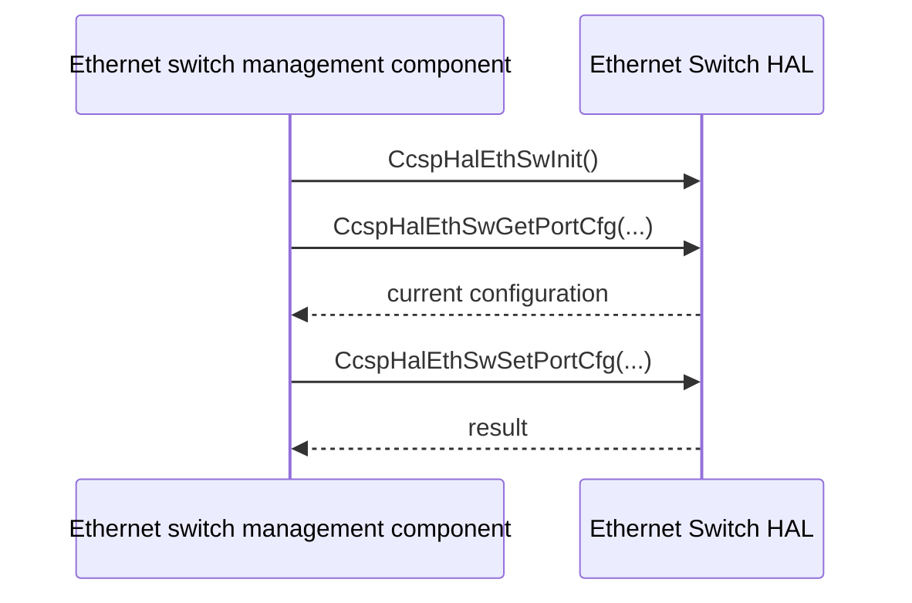

# Ethernet Switch HAL Specification

## Version History

| Date | Comment | Version |
| --- | --- | --- |
| — | Documentation alignment; no ABI change. | — |

## Acronyms
HAL means Hardware Abstraction Layer; WAN means Wide Area Network; MAC means Media Access Control.

## Description
The Ethernet switch management component uses this HAL for port configuration, status, statistics, associated-device notifications, and optional Ethernet WAN integration.

## Optional Components
WAN-manager and automatic-port-switching configurations expose product-dependent operations. Honor the header's conditional compilation.

## Component Runtime Execution Requirements
### Initialization and Startup
Call `CcspHalEthSwInit` once before dependent calls.
### Threading Model
Serialize configuration and shared state unless the vendor guarantees concurrency.
### Process Model
The library is used in process; coordinate other switch management writers.
### Memory Model
Callers own supplied buffers and structures unless an individual declaration states otherwise. Confirm ownership of returned device arrays with the vendor.
### Power Management Requirements
Port administrative enable/disable is not a general power-management protocol.
### Asynchronous Notification Model
`CcspHalExtSw_ethAssociatedDevice_callback_register` registers associated-device notification. `GWP_RegisterEthWan_Callback` supplies conditional WAN notification. Copy callback data needed later and confirm thread/lifetime behavior.
### Internal Error Handling
Check each operation's status and only inspect successful output.

## Nonfunctional Requirements
### Logging and Debugging
Implementations must not log credentials, secrets, security-sensitive information, or other sensitive data. Log operation outcomes rather than payloads.
### Quality Control
Use warning-clean builds, static analysis, and memory checks. Test port bounds and failed configuration without disrupting management access.
### Licensing
See repository Apache-2.0 notices.
### Build Requirements
Compile against the public header and product implementation; legacy packaging names `libhal_ethsw.so`.
### Variability Management
Compile and exercise only enabled feature branches; enum membership alone does not prove support.

## Interface API Documentation
| Area | Public operations |
| --- | --- |
| Lifecycle | `CcspHalEthSwInit` |
| Port status/configuration | `CcspHalEthSwGetPortStatus`, `CcspHalEthSwGetPortCfg`, `CcspHalEthSwSetPortCfg`, `CcspHalEthSwGetPortAdminStatus`, `CcspHalEthSwSetPortAdminStatus` |
| Learning and discovery | `CcspHalEthSwSetAgingSpeed`, `CcspHalEthSwLocatePortByMacAddress`, `CcspHalExtSw_getAssociatedDevice` |
| Notifications | `CcspHalExtSw_ethAssociatedDevice_callback_register`, `GWP_RegisterEthWan_Callback` |
| WAN configuration | `CcspHalExtSw_ethPortConfigure`, `CcspHalExtSw_getEthWanEnable`, `CcspHalExtSw_setEthWanEnable`, `CcspHalExtSw_getCurrentWanHWConf`, `CcspHalExtSw_getEthWanPort`, `CcspHalExtSw_setEthWanPort` |
| Statistics and WAN observation | `CcspHalEthSwGetEthPortStats`, `GWP_GetEthWanLinkStatus`, `GWP_GetEthWanInterfaceName` |

The linked header provides exact signatures, argument directions, return values, and feature gates.

### Theory of Operation and Key Concepts
For a partial port change, read the current configuration, modify intended fields, and apply it. Administrative state and observed link state are distinct.

### Sequence Diagram

## Source References
- [ccsp_hal_ethsw.h](https://github.com/rdkcentral/rdkb-halif-ethsw/blob/develop/include/ccsp_hal_ethsw.h)
